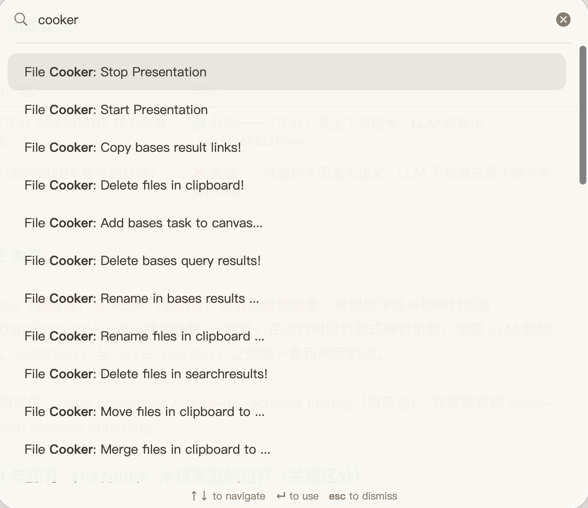

> 像做菜一样批量处理笔记：一次选择食材，一键下锅烹饪，确认后出锅 ✅
>
> [English README](README.md)

# File Cooker

File Cooker 是一款 Obsidian **批量文件处理插件**：把一批文件（来自搜索结果、剪贴板、当前文件链接、Dataview / Bases 查询……）当作「食材」，一条命令完成**移动、重命名、改属性、删除、合并、同步 flomo、加入 Canvas** 等「烹饪」操作。

- 🧺 **来源不限**：剪贴板 · 当前文件 · 搜索结果面板 · Dataview 查询 · Bases 查询 · 右键菜单
- 🍳 **操作丰富**：移动 / 重命名 / 编辑属性 / 删除 / 合并 / 创建 / 同步 flomo / 复制链接 / 加入 Canvas
- 🛡️ **安全确认**：所有操作执行前都会弹出确认窗口，删除等危险操作单独标红提醒
- 📱 **移动端可用**：非桌面独占（`isDesktopOnly: false`）

---

## ✨ 特性

- **批量编辑属性**：新增 / 修改 / 删除 frontmatter 属性；`tags` / `alias` / `cssclasses` 支持逗号分隔的多值编辑、`-` 前缀删除单个值；**无需再安装 MetaEdit 插件**（v1.8.0 起内置）
- **批量移动 / 重命名**：选中的文件一键整理到目标文件夹，或批量重命名
- **批量合并**：把多个文件合并到一个目标文件（合并时忽略 YAML）
- **批量创建**：把当前文件中的**未解析链接**一键补齐为真实文件
- **同步 flomo**：支持同步文件链接、文件内容、当前选区（需配置 flomoAPI）
- **复制链接**：把 Dataview / Bases 查询结果链接复制到剪贴板
- **加入 Canvas**：批量把文件、文本 / 选区、Dataview 任务添加进目标画布
- ⭐ **Bases 集成**（v2.0.0 新增）：直接对 Bases 查询结果执行文件操作
- ⭐ **右键菜单**（v2.0.0 新增）：编辑器 / 文件管理器右键直达
- **演示模式**（v1.9.0 新增）：一键放大字号、加宽编辑区，方便投屏阅读

## 📸 截图

> 演示：搜索结果 + 剪贴板 + Dataview 查询，三种来源统一走「选择 → 处理 → 确认」。



## 🍳 核心用法：选择 → 处理 → 确认

1. **选择（Select）**：通过任一来源选出一批文件
2. **处理（Cook）**：执行对应的操作命令
3. **确认（Confirm）**：在确认窗口中核对目标，确认后才会真正执行

### 支持的输入来源

| 来源 | 怎么用 | 说明 |
| :--- | :--- | :--- |
| 📋 剪贴板 | 先复制文件链接（如搜索结果），再执行「剪贴板」命令 | 纯文本内容也可加入 Canvas |
| 📄 当前文件 | 打开文件，执行「当前文件链接」命令 | 支持链接 / 未解析链接 / 内容 / 选区四种读取方式 |
| 🔍 搜索结果 | 打开 Obsidian 搜索结果面板，执行「搜索结果」命令 | 直接处理面板中的结果文件 |
| 📊 Dataview 查询 | 在编辑器中选中 DQL 或 DataviewJS 查询语句，执行「Dataview」命令 | 需要安装 [Dataview](https://github.com/blacksmithgu/obsidian-dataview) 插件；v1.7.1 起支持 DataviewJS |
| 🗄️ Bases 查询 | 打开 Bases 视图，执行「Bases」命令 | v2.0.0 新增，只处理可映射到真实文件的 row |
| 🖱️ 右键菜单 | 编辑器 / 文件管理器右键 | v2.0.0 新增 |

### 支持的操作

| 操作 | 命令示例 | 说明 |
| :--- | :--- | :--- |
| 📁 移动 | Move ... to folder | 批量移到目标文件夹 |
| ✏️ 重命名 | Rename ... | 批量重命名 |
| 🏷️ 编辑属性 | Edit Properties ... | 新增 / 修改 / 删除 frontmatter，支持多值 |
| 🔑 重命名属性 | Rename property in folder ... | 批量重命名属性键，属性值保持不变（v3.2.0 新增） |
| 🗑️ 删除 | Delete ... ! | 危险操作，执行前标红确认 |
| 🔗 合并 | Merge ... to ... | 合并到目标文件 |
| 🆕 创建 | Create links ... | 从未解析链接创建文件 |
| 📤 同步 flomo | Sync ... to flomo | 文件链接 / 内容 / 选区 |
| 📋 复制链接 | Copy ... links! | 复制到剪贴板 |
| 🖼️ 加入 Canvas | Add ... to canvas | 文件 / 文本 / 任务 |

### Bases 集成（v2.0.0 新增）

当 Bases 数据源可用时，File Cooker 提供与 Dataview 对齐的 Bases 命令组（移动 / 重命名 / 编辑属性 / 删除 / 合并 / 同步 flomo / 复制链接 / 加入 Canvas / 添加任务）。

边界说明：

- **仅文件映射**：只处理可映射到 vault 文件的 row
- **忽略非文件 row**：不可映射项会跳过，并在右下角提示忽略数量
- **不写入 row 字段**：本流程不会对 Bases row 字段做任何新增 / 修改 / 删除

### 右键菜单（v2.0.0 新增）

- **编辑器右键**：
  - `File Cooker > Selection`：同步选区到 flomo / 添加选区到 Canvas（仅在有选区时出现）
  - `File Cooker > Current file links`：对当前文件中的链接执行批量操作
- **文件管理器右键**：
  - `File Cooker > Target file`：对「被右键的文件」执行重命名 / 编辑属性 / 删除
  - `File Cooker > Target folder`（v3.2.0 新增）：对「被右键的文件夹」内**全部笔记（含子文件夹）**批量编辑属性 / 重命名属性键

> 说明：删除等危险操作仍会弹出确认窗口；不存在活动文件时，当前文件链接相关操作会被安全阻断并提示。

## 🛟 备份与撤销（新增）

所有批量写操作——**属性编辑 / 移动 / 重命名 / 删除 / 合并 / 创建**——执行前都会**自动快照**，之后你可以**撤销整批操作**或**逐文件勾选回滚**。

- **自动快照**：应用成功的操作会生成持久化备份记录（内容 + 路径）；取消或失败的操作不留任何残留
- **撤销历史**：`Undo last batch operation ...` 打开历史并聚焦最近一条记录；`Open backup & undo history ...` 列出全部记录（时间 / 类型 / 文件数 / 状态）
- **逐文件回滚**：展开记录后勾选要还原的文件即可回滚——移动/重命名走 Obsidian 反向改名（链接自动更新）、删除用快照重建、新建/复制文件直接删除
- **防覆盖（drift 检测）**：操作后被手动改过的文件会标记「已修改」并默认禁用，勾选「强制覆盖」才会覆盖；绝不静默覆盖用户数据
- **保留策略**：默认保留最近 20 条记录，更早的备份自动清理

> **备份目录**：备份存放在 vault 内（默认 `.file-cooker/backups`）。点号前缀默认在文件浏览中隐藏；如需彻底排除，可在 **设置 → 文件与链接 → 排除文件** 中添加（如 `.file-cooker`），避免进入搜索与关系图。
> **不在备份范围**：**Canvas** 操作与 **flomo** 同步不参与备份（分别走内部 API / 网络发送，不写 vault 文件）。

## 🤖 AI（实验性，新增）

AI 可按笔记内容推断 frontmatter 属性（tags / aliases / 自定义标量属性），生成提案供你审核，确认后批量应用。

- **多来源入口**：剪贴板 / 当前文件链接 / 搜索结果 / Dataview / Bases 结果均可触发，也支持右键单文件
- **提案先行**：审核确认前零写入；可编辑或取消勾选任意提案
- **多值合入**：tags / aliases 追加合入现有值（不覆盖）；标量属性仅在不存在时写入（可开覆盖开关）
- **可回滚**：AI 写入与普通批量操作一样生成备份记录，可在备份历史中回滚
- **默认关闭 & 隐私可控**：确认弹窗始终明示将发送的内容范围（文件名 + 前 N 字符，可配置）
- **OpenAI 兼容接入**：DeepSeek / Kimi / GLM / OpenRouter / Ollama（本地）均可使用

> 配置入口：设置 → File Cooker → AI（实验性）→ 开启并填写服务地址 / 模型 / API Key。
> 未配置时 AI 命令会提示并终止，不会发起网络请求。

### 🍳 工作台：查询 → 确认 → 执行 单一入口（新增）

命令 **打开 File Cooker 工作台 ...**（或左侧 ribbon 图标）打开三步向导：

1. **查询** — 七种来源任选：AI 生成（一句话 → DQL / 搜索 / Bases）、手写 DQL / 搜索 / Bases（**带语法检查**）、经典三来源（搜索面板结果 / 剪贴板 / 当前文件链接）
2. **确认** — 核对命中文件清单（超出批量上限会明确提示截断）
3. **执行** — 从分组操作目录（编辑属性 / AI 补全 / 移动 / 合并 / Canvas / 改名 / 删除）中选择，所有写入仍走确认窗 + 备份回滚

步骤间往返导航，输入内容全程保留。既有命令全部保留为快捷方式。

**已有的脚本可以直接复用**：手写脚本面板的「从笔记导入…」可从任意笔记的 ` ```dataview ` / ` ```query ` 代码块或已保存的 `.base` 文件中提取脚本填入输入框，并自动执行语法检查。

### 🗣️ 自然语言找文件（新增）

输入一句话，如"去年标记了读书但没读完的笔记"——AI 会把它**同时编译成 DQL、搜索语法和 Bases 筛选**（本地确定性编译），三份查询并排预览，确认后选一种执行。命中的文件直接进入 File Cooker 批量管线（编辑属性 / 移动 / 改名 / 删除 / Canvas / flomo），并完整支持备份回滚。

- 一次输入，**三种查询语言**（DQL 目标需安装 Dataview 插件）
- 执行前查询文本可编辑；Bases 可另存为 `.base` 文件
- 执行为只读；写入只发生在分发到批量操作并确认之后
- 仅发送你的一句话 + 库内元数据（标签/属性/目录清单），不发送笔记正文

## ⚙️ 设置

| 设置项 | 作用 | 默认值 |
| :--- | :--- | :--- |
| 界面语言 | 弹窗 / 通知 / 设置页的显示语言：`自动` 跟随 Obsidian 界面语言（中文界面显示中文，其他显示英文），也可固定中文 / 英文 | `自动` |
| Limit | 单次批量处理的文件数量上限 | `300` |
| flomoAPI | flomo API 地址，用于同步笔记到 flomo | 空 |
| 启用备份 | 每个批量写操作执行前生成快照以便回滚 | 开 |
| 备份目录 | 备份存放的 vault 内目录（点号前缀默认隐藏） | `.file-cooker/backups` |
| 保留次数 | 保留最近几条备份记录 | `20` |
| AI（实验性） | 启用 AI 属性补全及服务地址 / 模型 / API Key / 批量参数 / 推断项配置 | 关 |

> flomo 同步类命令在未配置 API 时会提示「Please config flomoAPI first!」。

## 📦 安装

### 方式一：官方插件市场（推荐）

1. 设置 → 第三方插件 → **关闭安全模式**
2. 点击 **浏览**，搜索 **File Cooker**
3. 点击 **安装**，安装完成后**启用**即可

### 方式二：手动安装

1. 下载[最新版本](https://github.com/ivaneye/obsidian-files-cooker/releases/latest)
2. 解压 `obsidian-file-cooker` 文件夹到 `<vault>/.obsidian/plugins/` 目录下
   > 提示：某些机器上 `.obsidian` 目录是隐藏的，macOS 可按 `Command+Shift+Dot` 显示
3. 重启 Obsidian 并在设置中启用插件

### 依赖说明

- Obsidian ≥ **1.12.3**（v2.0.0 起）
- **Dataview** 插件：仅使用「Dataview 查询」来源时需要
- **flomoAPI**：仅使用「同步 flomo」命令时需要
- 其余功能开箱即用，无额外依赖

## 🛡️ 安全与限制

- **全程确认**：所有命令执行前都会弹出确认窗口，避免误操作
- **删除标红**：删除类命令在确认窗口中标红提示
- **先备份后应用**：每个批量写操作先快照再执行，可从历史回滚；操作后被改过的文件绝不静默覆盖
- **数量上限**：单次批量处理默认不超过 300 个文件，可在设置中调整
- **失败可见**：无文件、无活动文件、配置缺失等情况均以 Notice 提示，不会静默失败

## 💬 反馈与支持

使用中遇到任何问题或建议，欢迎**加微信讨论：`IvyOdds`**，或在 [GitHub Issues](https://github.com/ivaneye/obsidian-files-cooker/issues) 反馈。

如果 File Cooker 对你有帮助，欢迎分享给身边用 Obsidian 的朋友 🙏

## 📜 开源规范

- 遵循 MIT 协议，详见 [LICENSE](./LICENSE)
- 欢迎提 issue、PR 参与共建

## 📝 更新日志

### 2.2.0

- 新增 **备份与撤销**：所有批量写（属性 / 移动 / 重命名 / 删除 / 合并 / 创建）执行前自动快照，可从历史逐文件回滚；drift 检测防止静默覆盖
- 新增设置项：备份总开关、备份目录、保留次数

### 2.0.0

- 新增 **Bases 查询**作为文件批处理来源（仅处理可映射文件的 row，不修改 Bases 字段）
- 新增 **右键菜单**入口（编辑器：选区 / 当前文件链接；文件管理器：目标文件）
- 升级 Obsidian 依赖至 1.12.3

### 1.9.0

- 新增 **演示模式**：一键放大字号、加宽编辑区，方便投屏阅读

### 1.8.1

- 属性编辑支持**多值属性**：`tags` / `alias` / `cssclasses` 逗号分隔批量增删

### 1.8.0

- 内置**批量属性编辑**，无需再安装 MetaEdit 插件

### 1.7.8

- 新增**搜索结果**命令，可直接处理搜索结果面板

### 1.7.7

- 支持添加 **Dataview Task** 到 Canvas

### 1.7.6

- 支持添加**文本**到 Canvas

### 1.7.1

- 支持 **DataviewJS** 页面查询语句

### 1.7.0

- 支持批量添加**文件**到 Canvas

### 1.0 ~ 1.6

- 基础能力：移动、重命名、合并、删除、从未解析链接创建、同步 flomo、复制链接

---

## ☕ Buy me a coffee

<div display="flex">
  
  <span style="margin:0 3px"></span>
  
</div>
