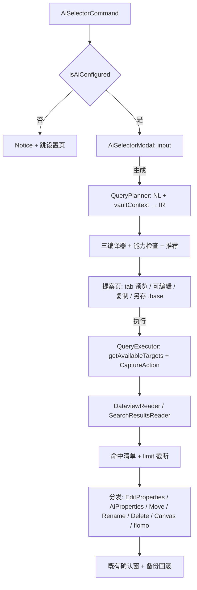

## Context

实现基线为 `docs/ai-module-design.md` §6（三语法通译实施基线）。P1 已交付并复用的地基：`AiSettings`（本变更新增 `vaultContext` 字段）、`AiProvider`（chatJson + JSON 提取 + response_format 降级）、`buildTagVocabulary`、`isAiConfigured`/`loadAiApiKey`。既有承接面：`DataviewReader`（构造函数直接吃 queryStr，LIST/TABLE/TASK 返回已处理）、`SearchResultsReader`（读 `resultDomLookup`）、Bases 行探测读取、`ActionModel[]`/`Action` 管线、`ChooseFolderModal`/`ChooseFileModal`/`ChooseCanvasModal` 接受 Reader 的分发改写模式。

约束：与旧稿差异已固化——不新增 `AiReader`，编排经 CaptureAction 复用既有 Reader；不注入全库路径清单；无持久会话。

## Goals / Non-Goals

**Goals**

- IR + 三编译器 + 能力检查 + 推荐链：可测试的纯函数核心
- 三通道执行：DQL / 搜索注入 / Bases 产物导出（P3a 无 Bases 程序化执行）
- 命中清单 → 既有 Action 分发，写入全部沿用既有确认窗 + 备份回滚
- Dataview 可用性驱动的 tab 可见性（单一事实来源函数）

**Non-Goals**

- 不做 Bases 程序化执行（P3b：临时 `.base` 注入）
- 不做模态框内追问（`previousIR + instruction` 增强位，按反馈后续迭代）
- 不注入笔记正文（仅自然语言 + 元数据词表）
- 不实现 `task` 条件的 DQL/Bases 表达（仅搜索语法；DQL TASK 语义与文件级属性过滤混合存在歧义）

## Decisions

### D1：IR 契约（v1）

```ts
type CompareOp = 'gt' | 'gte' | 'lt' | 'lte';
type PropertyOp = 'eq' | 'notEquals' | 'contains' | 'isEmpty' | CompareOp;
type IrCondition =
    | { tag: string } | { folder: string } | { filename: string }
    | { property: { field: string; op: PropertyOp; value: string | number | boolean } }
    | { fileModified: { op: CompareOp; date: string } } | { fileCreated: { op: CompareOp; date: string } }
    | { content: string } | { task: 'todo' | 'done' }
    | { and: IrCondition[] } | { or: IrCondition[] } | { not: IrCondition };
interface QueryIR { irVersion: 1; intent: string; conditions: IrCondition; }
```

`validateQueryIR(raw: unknown): QueryIR` 做结构校验（版本、节点白名单、字符串规范化），非法抛错。理由：状态浓缩在一个 JSON，改需求 = 改字段本地重编译，天然免会话。

### D2：编译器为纯函数，返回 `{ text, unsupported }`

每个编译器遍历 IR 树，能表达的节点翻译为目标语法，不能表达的节点进入 `unsupported` 清单（不参与该目标语义）：

| IR 节点 | DQL | 搜索 | Bases |
|---|---|---|---|
| tag | `FROM #t` | `tag:#t` | `file.hasTag("t")` |
| folder | `FROM "f"` | `path:"f"` | `file.inFolder("f")` |
| filename | `contains(file.name,"x")` | `file:x` | `file.name.contains("x")` |
| property eq/neq | `f = v` / `f != v` | `[f:v]` / `-[f:v]` | `f == v` / `f != v` |
| property contains | `contains(f,v)` | `[f:v]`（尽力匹配） | `f.contains("v")` |
| property isEmpty | `!f` | `[f:null]` | `f.isEmpty()` |
| 数值/日期属性比较 | `f >= v` | 不支持 | `f > v` |
| fileModified/Created | `file.mday >= date(d)` | 不支持 | 不支持（待验证） |
| content | 不支持 | `content:x` | 不支持 |
| task | 不支持（见 Non-Goals） | `task-todo:()` / `task-done:()` | 不支持 |
| and/or/not | `AND`/`OR`/`!(...)` | 空格/`OR`/`-(...)` | YAML `and`/`or` 键（仅顶层，嵌套布尔标注不支持） |

DQL 的 FROM 仅承载 tag/folder（OR 语义），其余进 WHERE。Bases 产物附最小 `views`（table）保证打开即可见。

### D3：能力检查与推荐——单一事实来源

`query-executor.ts` 导出 `getAvailableTargets(): QueryTarget[]`（`getAPI() != null` → dql；search 恒可用；bases 恒可用），tab 渲染与推荐共用。推荐 = 可用集合内 `unsupported` 为空且优先级最高者（dql > search > bases）；无完整表达目标时不自动执行。Dataview 缺席且 IR 含仅 DQL 可表达条件（如日期比较）→ 隐藏 DQL 选项 + 搜索目标标注"N 个条件不支持（已忽略）" + 底部提示安装 Dataview——退化不静默。

### D4：执行编排——CaptureAction 复用三个既有 Reader

```ts
class CaptureAction implements Action {
    readonly promise: Promise<ActionModel[]>;
    act(models: ActionModel[]): void { this.resolve(models); }
}
```

- DQL：`new DataviewReader(plugin, text).read(capture)` → await promise（超时 20s 抛错，避免查询错误时永久挂起）
- 搜索：`searchView.setQuery(text)`（内部 API，运行时验证）→ 轮询 `dom.resultDomLookup.size` 稳定（间隔 150ms，连续 2 次一致视为稳定，上限 5s）→ `new SearchResultsReader(plugin).read(capture)`；`setQuery` 不存在时降级：打开搜索面板填入查询 + Notice 指引回车
- Bases：P3a 仅生成 + 另存 `.base`（vault 根目录，`AI-query-<时间戳>.base`）+ 打开；执行属 P3b

命中文件按 `settings.limit` 截断（复用 ReadInfo 既有护栏语义，executor 内显式 slice + 提示）。

### D5：规划器与库内上下文

`QueryPlanner.generate(input)`：system prompt 携带 IR v1 Schema、节点说明、约束（标签必须来自词表、日期以今天为锚点解析、严格 JSON）；user 内容为 `{input, context}` JSON。上下文采集 `collectVaultContext(app)`：标签词表（`getTags()`，上限 200）、属性键（`getAllPropertyInfos()`，上限 100，API 缺失时空表）、顶层/二级目录（上限 100）、今天日期（ISO）。响应经 `extractJsonObject`（P1 已有）+ `validateQueryIR` 双重校验。`AiSettings` 新增 `vaultContext: boolean`（默认 true，MVP 恒开不进设置 UI）。

### D6：模态框三态与分发

`AiSelectorModal`（app, plugin, deps{planner, executor}）三态：

```
input（textarea + 生成）
  → query（解释 + 可用目标下拉（含不支持计数）+ 查询文本可编辑 textarea
          + 不支持条件警示 + [执行] [复制] [另存为 .base（仅 bases）] [重新输入]）
  → results（命中数 + 截断提示 + 文件清单 + 分发按钮组 + [重新输入]）
```

分发经既有入口复用：编辑属性 → `EditPropertiesAction`；AI 属性 → `AiPropertiesAction`；移动 → `ChooseFolderModal(app, readerAdapter, factory)`；合并 → `ChooseFileModal`；Canvas → `ChooseCanvasModal`；改名/删除/flomo → 对应 Action。`readerAdapter = { read(action) { action.act(models) } }` 将命中清单伪装成 Reader，分发改写零改动。命令未配置 AI → Notice + `setting.openTabById` 跳设置页。

### D7：调用链路



## 测试策略

- **框架与组织**：vitest，`tests/ai/`；核心纯函数（query-ir、三编译器、推荐链、planner 校验）走 TDD
- **Mock/Stub**：`obsidian-dataview` 以 `vi.mock` 控制 `getAPI` 模拟 Dataview 可用性；Reader 以模块 mock 验证 executor 分发；真实搜索面板注入 / Bases 另存打开为手工验收
- **层次**：query-ir（合法/非法结构、节点白名单、规范化）；三编译器（每节点 golden 断言、嵌套布尔、unsupported 标注、转义）；推荐链（可用集合过滤、优先级、无完整表达不自动执行）；planner（上下文注入、响应校验、extractJson 复用）；selector modal（三态流转、目标下拉过滤、编辑后按新文本执行、分发调用）
- **注释**：测试含目的/内容/预期；实现说明职责与关键语义

## Risks / Trade-offs

- [LLM 产出 IR 不准] → 解释 + 三语预览对照 + IR 推导出的查询文本可编辑；错误输入不落盘只影响一次查询
- [搜索注入内部 API 演进] → 存在性探测 + 降级填入面板；调用点集中在 query-executor 单文件
- [三语法表达力差异造成困惑] → 编译期 unsupported 明示"已忽略"；推荐执行器徽标
- [Bases YAML 与真实语法偏差] → P3a 仅产物模式（打开后可在 Bases 编辑器调整），程序化执行延后至 P3b
- [隐私] → 仅发送自然语言 + 元数据词表，无笔记正文；spec 明确约束

## Migration Plan

纯新增能力 + `AiSettings` 增一个默认 true 的字段（deepMerge 白名单合并已保证旧数据平滑迁移）。回滚 = 不使用该命令；无数据迁移。

## Open Questions

（无——Bases 函数真实语法、搜索 setQuery 行为列入 6.x 手工验收项。）
